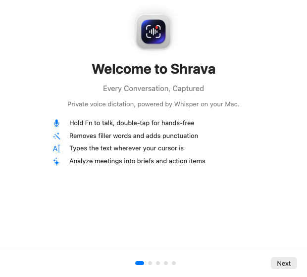
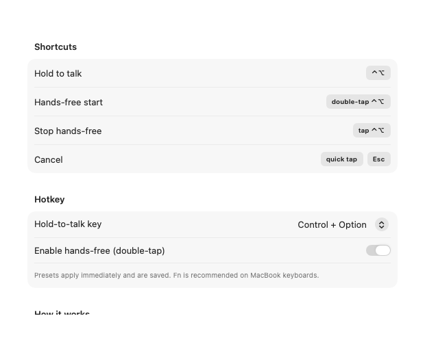
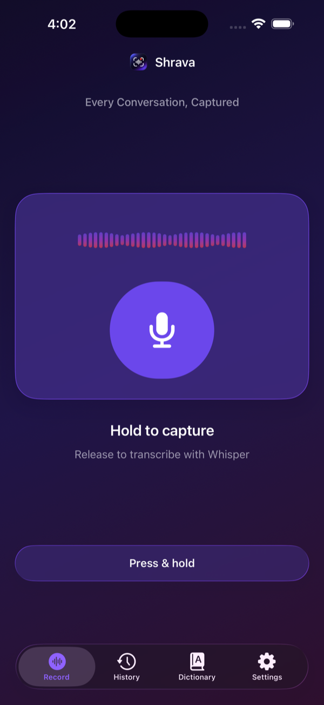
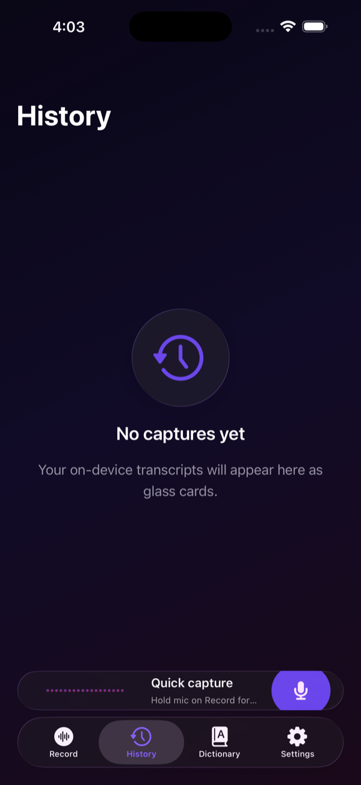
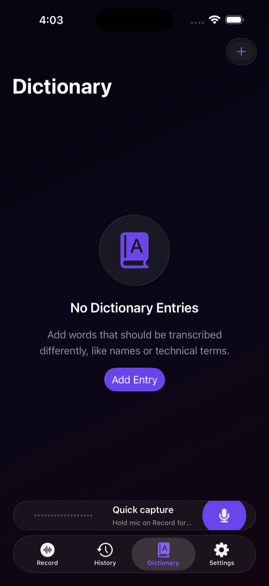
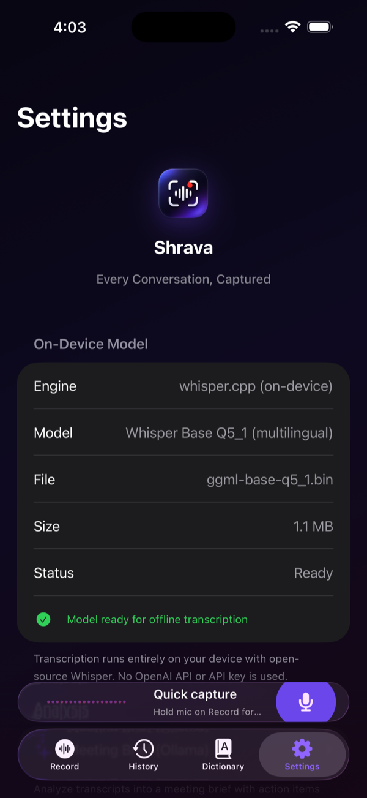

# Shrava

**Every Conversation, Captured.**

Local-first voice dictation and meeting capture for **macOS** and **iPhone**. Hold a key (or tap Record), speak naturally, and get clean on-device transcripts — with optional Meeting Brief insights when you ask for them.

## Download

| Platform | Download |
|---|---|
| **macOS** (Apple silicon, macOS 14+) | [**Download Shrava.dmg**](https://github.com/nitinkanish/shrava-ai/raw/main/dist/Shrava.dmg) |
| **iPhone** (iOS 26+) | Not on the App Store. Install from source with Xcode and a free Apple ID; see [iPhone (free Apple ID)](#iphone-free-apple-id). |

> The Mac app is ad-hoc signed. On first open, right-click Shrava.app > **Open**, or run `xattr -dr com.apple.quarantine ~/Applications/Shrava.app`.

## Highlights

| Desktop (macOS 14+) | Mobile (iOS 18+) |
| --- | --- |
| Hold **Fn** to dictate into any app | Liquid Glass UI |
| Double-tap Fn for **hands-free**; tap again to stop | Long **background** meeting recording |
| Local Whisper via **whisper-cli** (`large-v3-turbo`) | On-device Whisper **base** (`ggml-base-q5_1`) |
| Draggable creative recording indicator + menu-bar logo | Compact **Dynamic Island** / Live Activity with **Stop** |
| **Meeting Brief** via Ollama (`gpt-oss:120b-cloud`) | Action Button / Siri / Control Center start **without opening the app** |
| History, dictionary, settings tabs | Keyboard extension, history, dictionary, meeting brief |
| Ad-hoc **DMG** for local install | Copy / Share transcript as `.md` |

Audio never leaves your device for transcription. Meeting Brief text is sent to Ollama **only when you tap Analyze**.

---

## Desktop

Menu-bar app: hold your hotkey, speak, release — polished text is typed into the focused field.


| Welcome | Hotkey settings |
|:---:|:---:|
|  |  |

### Features

- **Hold Fn dictation** (or Control+Option / custom hotkey) with a floating, **draggable** recording indicator and custom Shrava menu-bar logo
- **Hands-free mode**: double-tap the hotkey to start, tap again to stop
- **Local Whisper** through Homebrew `whisper-cli` / whisper.cpp — prefers `ggml-large-v3-turbo` in Application Support
- **Meeting Brief**: send a transcript to **Ollama** (`gpt-oss:120b-cloud`, with non-cloud fallback) for insights and action items — API key stored in **Keychain**
- Searchable **history**, personal **dictionary**, and Settings tabs (General, Hotkey, Model, Permissions, Meeting Brief, …)
- Distribute as a local **DMG** (`dist/Shrava.dmg`) for ad-hoc install into `~/Applications`

### Install (Mac)

1. Open `dist/Shrava.dmg` (or build from source below) and drag **Shrava** to Applications (or `~/Applications`).
2. First launch: grant **Microphone** and **Accessibility** (needed for Fn and typing into other apps).
3. Install Whisper runtime if needed: `brew install whisper-cpp` (provides `whisper-cli`).
4. Place a ggml model (e.g. `ggml-large-v3-turbo-q5_0.bin`) in  
   `~/Library/Application Support/Shrava/models/`  
   (Settings → Model shows the folder and readiness).
5. Optional Meeting Brief: open Settings → **Meeting Brief**, choose Ollama endpoint mode, and save your Ollama API key (Keychain).

**Usage:** hold **Fn** to talk; release to insert text. Double-tap Fn for hands-free. Open History / Dictionary / Settings from the menu bar.

---

## Mobile

iPhone app with Liquid Glass chrome, long-form meeting capture, and Shortcuts that record in the background.

| Record | History |
|:---:|:---:|
|  |  |

| Dictionary | Settings |
|:---:|:---:|
|  |  |

### Features

- **Liquid Glass** UI (iOS 26 design language)
- **Long background recording** (switch apps / lock screen) with AAC capture
- **Dynamic Island** + Lock Screen **Live Activity** — compact mic + narrow timer; **Stop** ends recording without opening the app
- **App Intents** (`AudioRecordingIntent` + `LiveActivityIntent`, `openAppWhenRun = false`):
  - *Start Shrava Recording* / *Stop* / *Toggle* for **Action Button**, **Back Tap**, **Shortcuts**, and **Siri**
  - **Control Center** control (`Shrava Recording`) toggles recording without launching UI
- On-device **Whisper base** model (download once in Settings) — no OpenAI key
- **Meeting Brief** (Ollama) with insights / action items; **Copy** and **Share as `.md`**
- **Shrava Keyboard** for quick capture from other apps (Full Access recommended when App Groups are available)

### Action Button (start without opening the app)

1. **Settings → Action Button → Shortcut**
2. Under **Shrava**, choose **Start Recording** / **Start Shrava Recording**
3. Press the Action Button — recording + Live Activity start; the app stays in the background

### Control Center

1. Open Control Center → **+** / Edit Controls  
2. Add **Shrava Recording**  
3. Tap to start/stop without opening Shrava  

> **Note (free Apple ID):** personal-team builds expire about every **7 days** and must be reinstalled from Xcode. App Groups / iCloud may be unavailable on free signing, so keyboard ↔ app sharing can be limited.

---

## Privacy

- **Transcription audio stays on device** (Mac: whisper-cli; iPhone: embedded whisper.cpp).
- **Meeting Brief** sends transcript **text** to Ollama only when you tap **Analyze** (not while recording).
- Ollama API keys (if used) are stored in the **Keychain** — never commit keys to git or the README.
- No OpenAI account is required for dictation.

---

## Build from source

### Prerequisites

- macOS with **Xcode 16+** (iOS 18 / 26 SDK)
- [XcodeGen](https://github.com/yonaskolb/XcodeGen): `brew install xcodegen`
- Mac dictation: `brew install whisper-cpp` + a ggml model under Application Support (see above)
- iOS Whisper binary framework:

```bash
./scripts/fetch-whisper-xcframework.sh
```

### Generate & open

```bash
cd Shrava
xcodegen generate
open Shrava.xcodeproj
```

### macOS (ad-hoc / local)

1. Scheme **ShravaMac**
2. Signing: your Personal Team or ad-hoc; empty entitlements override is fine for local use
3. Build & run (or archive → DMG for `~/Applications`)

### iPhone (free Apple ID)

1. Connect your iPhone; scheme **ShravaIOS**
2. Signing & Capabilities: select your **Personal Team** (free Apple ID)
3. Run to device  
4. Re-sign / reinstall about every **7 days** when the free provisioning profile expires  
5. First launch: allow Microphone; download the Whisper base model in Settings; enable Live Activities for Shrava if prompted  

For background shortcut recording, grant mic once in-app, then use Action Button / Control Center / Siri as above.

### Project layout

```
Shrava/
├── project.yml                 # XcodeGen
├── scripts/fetch-whisper-xcframework.sh
├── ShravaCore/                 # Shared models, history, dictionary, Ollama client, Keychain
├── ShravaMac/                  # Menu bar app, hotkeys, LocalWhisper, Meeting Brief UI
├── ShravaIOS/                  # Host app, recorder, intents bridge, Liquid Glass UI
├── ShravaKeyboard/             # Keyboard extension
├── ShravaLiveActivity/         # Live Activity + Control Center widget
├── Shared/                     # Recording intents, activity attributes, constants
├── docs/screenshots/           # README screenshots (committed)
└── dist/                       # Local DMG / preview dumps (not all committed)
```

---

## Troubleshooting

| Issue | What to try |
| --- | --- |
| Fn does nothing (Mac) | Toggle Shrava off/on under **System Settings → Privacy & Security → Accessibility** |
| `whisper-cli not installed` | `brew install whisper-cpp`; confirm Settings → Model |
| Model not ready (Mac) | Drop `ggml-large-v3-turbo*.bin` into Application Support → Shrava → models |
| Model not ready (iPhone) | Settings → download Whisper base; keep the app open until finished |
| Shortcut opens the app | Use the **Start Shrava Recording** App Shortcut (not an Open App / URL action) |
| Live Activity missing | Settings → Shrava → Live Activities; AudioRecordingIntent requires an active Live Activity |
| Free-team install expired | Rebuild/run from Xcode (≈7-day personal provisioning) |

---

## License & credit

© 2026 Shrava. Developed by Nitin Kanish, [Debugged Pro](https://debuggedpro.com).

Clean-room implementation. No third-party dictation app code, assets, or prompts.
